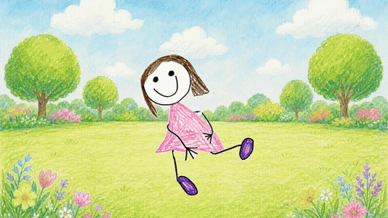
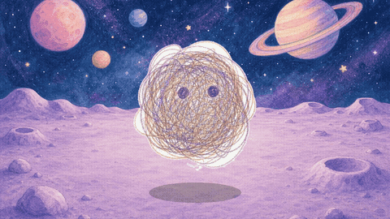
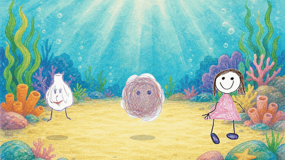
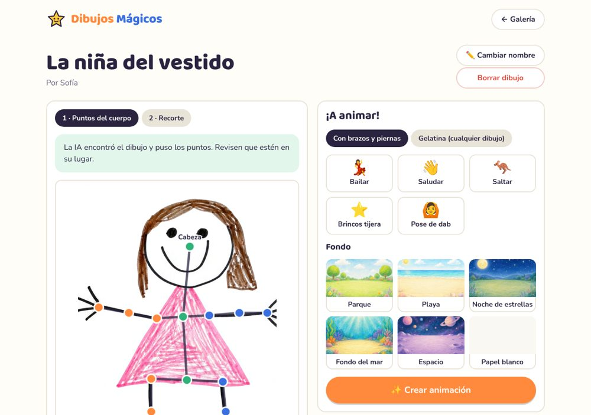

# Dibujos Mágicos ✨

Una foto de un dibujo de las niñas → un video **con música** donde el dibujo **baila, saluda, salta** o **rebota como gelatina**, con fondos de parque, playa, noche, mar, espacio, granja, bosque, jardín o nieve, y con su música o **canciones propias de la familia**. Varios dibujos pueden bailar juntos en una **fiesta**. Después se ven todos en grande en la tele con el **modo función**.

Todo corre en su computadora: las fotos y los videos no salen de la casa.

| Con brazos y piernas | Gelatina (cualquier garabato) |
|---|---|
|  |  |

**Fiesta:** varios dibujos juntos, cada uno a su manera y al mismo ritmo.

---

## Qué necesitan

- Una computadora con **Windows 10 u 11** (de 64 bits). También funciona en Mac o Linux.
- **8 GB de RAM** o más (16 GB es mejor).
- Unos **15 GB libres** en el disco.
- Internet **solo la primera vez**, para descargar todo.
- No hace falta tarjeta de video.

## Instalarlo (una sola vez)

### 1. Instalar Docker Desktop

Docker es el programa que corre las "cajitas" donde vive Dibujos Mágicos, para no tener que instalar nada más a mano.

1. Descárguenlo de <https://www.docker.com/products/docker-desktop/> (el botón "Download for Windows").
2. Ábranlo y acepten las opciones que vienen marcadas. Si pide reiniciar, reinicien.
3. Abran **Docker Desktop**. La primera vez pide aceptar los términos; no hace falta crear cuenta (pueden darle "Skip").
4. Esperen hasta que abajo a la izquierda diga **Engine running** (en verde).

> Si Docker dice que falta **WSL**, abran "Símbolo del sistema" y escriban `wsl --install`, reinicien y vuelvan a abrir Docker Desktop.

### 2. Descargar Dibujos Mágicos

1. En la página del repositorio en GitHub, botón verde **Code → Download ZIP**.
2. Descompriman el ZIP, por ejemplo en `Documentos`.
3. Entren a la carpeta `dibujos-magicos`.

### 3. Arrancarlo

Doble clic en **`Iniciar Dibujos Magicos.bat`**.

- **La primera vez tarda entre 20 y 60 minutos**: descarga la IA de Meta y prepara todo. Pueden dejarlo trabajando. Si Windows pregunta por el firewall, den **Permitir** (en redes privadas) para poder usarlo desde el celular.
- Cuando termina se abre solo el navegador en **http://localhost:8000**.
- Las siguientes veces arranca en segundos. Si no lo detuvieron con el `.bat` de abajo, arranca solo cada vez que abren Docker Desktop.

Para apagarlo: doble clic en **`Detener Dibujos Magicos.bat`**.

En Mac o Linux, en vez del `.bat`, abran la terminal en la carpeta y escriban `./iniciar.sh`.

---

## Usarlo

1. **＋ Nuevo dibujo**: tomen la foto (desde el celular es más fácil), pónganle nombre y quién lo dibujó.
2. En unos segundos la IA recorta el dibujo y adivina dónde están la cabeza, los brazos y las piernas.
3. **Revisen los puntos**: si alguno quedó mal, arrástrenlo a su lugar (cabeza, pecho, cadera; y en cada lado hombro → codo → mano y cadera → rodilla → pie). Le den a **Guardar cambios**.
4. Si al recorte le falta un pedazo o le sobra papel, vayan a **2 · Recorte** y usen 🖌️ para agregar o 🧽 para quitar.
5. Elijan un **movimiento**, un **fondo** y una **canción**, y **✨ Crear animación**. Tarda entre 10 segundos y un minuto.
6. Pueden **descargar** el video para mandarlo a la familia.

### Música

Cada movimiento trae una canción sugerida, y se puede cambiar (tocar una canción la deja escuchar unos segundos):

| Canción | Para qué va bien |
|---|---|
| ⭐ Estrellita | saludar, tranquila |
| 🌙 Canción de cuna (Brahms) | flotar, para antes de dormir |
| 🪇 La cucaracha | dab, bambolear |
| 🎉 Fiesta de colores | bailar, menearse |
| 🐸 Saltarín | saltar, brincos, rebotar |
| 🔔 Martinillo | tranquila, para cantar |
| 🎻 Himno de la alegría | tranquila |
| 🐮 El viejo MacDonald | saltar, rebotar |
| 🥁 Cumbia alegre | bailar, menearse |

Fiesta de colores, Saltarín y Cumbia alegre son originales de este proyecto; las demás son canciones tradicionales o clásicas de dominio público. Todas las toca un sintetizador incluido en el programa (cajita de música, marimba, xilófono, acordeón, güiro…), así que no hay problemas de derechos. Mientras suena la muestra de una canción aparece un botón **⏹ Parar**, y nunca suenan dos cosas a la vez. Los personajes gelatina se mueven al ritmo de la canción. El volumen está pensado para oídos pequeños.

### Mis canciones (música de la familia)

Botón **🎵 Mis canciones** en la página principal, o el enlace "＋ Agregar mis canciones" debajo de la música:

1. Elijan un archivo de música (MP3, M4A, WAV, OGG o FLAC), desde el celular o la compu.
2. Pónganle nombre y, si quieren, desde qué segundo empieza (por ejemplo, donde arranca el coro).
3. **Subir canción.** La app empareja el volumen y calcula el ritmo, para que los dibujos bailen al compás.

Después aparece con 🎵 junto a las demás canciones al animar o armar una fiesta. Se pueden cambiar el inicio y el nombre, o borrarla (los videos que ya la usan no cambian).

Sirven las canciones que tengan como archivo (compradas, de un CD) o grabaciones de ustedes cantando. Las de Spotify o YouTube no se pueden descargar como archivo. Para usar Spotify, pongan la música en la tele o el celular y en el modo función quiten "🔊 Con música". Las canciones propias se guardan solo en la computadora, en `datos/canciones`, y no se suben a GitHub.

### Fiesta: varios bailando juntos

Botón **🎉 Fiesta** en la página principal:

1. Toquen de 2 a 5 personajes, en el orden en que quieren que salgan (de izquierda a derecha).
2. Debajo de cada uno se puede cambiar si baila **con brazos y piernas** o como **gelatina**. Así un garabato de la bebé puede bailar junto a los dibujos de su hermana.
3. Elijan el baile, el fondo y la canción, y **🎉 Crear fiesta**. Los de brazos y piernas hacen todos el mismo baile; los gelatina hacen su versión, al mismo ritmo.

### Desde el celular (no hace falta pasar las fotos a la compu)

En la página principal aparece un **código QR**. Escanéenlo con la cámara del celular (tiene que estar en el mismo WiFi que la computadora). Se abre Dibujos Mágicos en el celular y desde ahí:

- **＋ Nuevo dibujo → Tomar foto**: abre la cámara, toman la foto del dibujo y se sube sola a la computadora.
- También pueden elegir una foto que ya tengan en el celular (por ejemplo, una que les mandaron por WhatsApp).
- Todo lo demás (acomodar puntos, animar, ver los videos) también se puede hacer desde el celular.

La computadora solo tiene que estar prendida con Dibujos Mágicos corriendo. Guarde la dirección como favorito en el celular para la próxima vez.

### En la tele: modo función

Botón **▶ Modo función**. Pasa todos los videos y fiestas uno tras otro, con música y con el nombre del personaje y de la artista antes de cada uno. Hay tres formas de verlo en la tele:

1. **Cable HDMI** (la más sencilla y la que mejor funciona): un cable HDMI de la computadora a la tele. En la tele elijan esa entrada HDMI. En Windows, `tecla Windows + P` → **Duplicar** para ver lo mismo en las dos pantallas. Si la compu está lejos de la tele, hay cables HDMI de 5 o 10 metros. El sonido sale por la tele.
2. **Smart TV**: abran el navegador de la tele y escriban la dirección que sale debajo del QR, agregando `/funcion` (por ejemplo `http://192.168.1.50:8000/funcion`). La tele tiene que estar en el mismo WiFi. Algunos navegadores de tele son lentos o no reproducen video; si pasa, usen otra opción.
3. **Chromecast o Google TV**: en Chrome de la computadora, menú ⋮ → **Transmitir…** → elijan la tele y **Transmitir pestaña**. Luego abran el modo función.

**A la tele no se le sube nada:** todo queda guardado en la computadora. La tele solo pasa los videos, y los nuevos que hagan desde el celular aparecen solos en unos segundos. Para ponerlo **ya**, toquen **📺 Ver en la tele** debajo de cualquier video o fiesta en el celular, y la tele lo pone enseguida.

En la pantalla de inicio del modo función se puede apagar la música. Con las flechas ← → del teclado se cambia de video.

### Dos tipos de movimiento

- **Con brazos y piernas**: bailar, saludar, saltar, brincos tijera y dab usan movimientos reales de personas, capturados por Meta. **Aplaudir, marchar, avión y ¡hurra!** son bailes hechos para este proyecto, que van al ritmo de la canción. Funcionan con dibujos de personas, animales parados, monstruos… cualquier cosa con dos brazos y dos piernas separados del cuerpo.
- **Gelatina**: rebotar, bambolear, flotar, menearse, **trompo** (con polvito), **nadar** (con burbujas), **cohete** (despega con fuego y humo) y **voltereta** (aterriza con estrellitas). Funcionan con **cualquier dibujo**, incluso los garabatos de la bebé, y se mueven al ritmo de la canción. Cuando la IA ve que un dibujo no tiene brazos ni piernas, deja este modo seleccionado.

### Consejos para fotos que salgan bien

- Papel blanco, foto de frente (desde arriba) y con buena luz, sin sombras fuertes.
- Que el dibujo llene casi toda la foto.
- Los trazos gruesos (crayola, marcador) funcionan mejor que el lápiz.
- Para que pueda bailar: brazos y piernas que no se toquen con el cuerpo.

---

## Dónde quedan los dibujos y videos

En la carpeta **`datos`**, dentro de `dibujos-magicos`. Cada personaje tiene su carpeta con la foto original, el recorte y la carpeta `videos`. Si copian la carpeta `datos` a otra compu, se llevan todo.

## Si algo falla

| Qué pasa | Qué hacer |
|---|---|
| "Docker Desktop no está abierto" | Abran Docker Desktop, esperen "Engine running" y vuelvan a abrir el `.bat`. |
| La primera instalación se cae con "killed" o "out of memory" | Cierren otros programas y vuelvan a intentar. En Docker Desktop → Settings → Resources pueden darle más memoria. |
| La página dice "La magia se está despertando" mucho rato | La IA tarda 1–2 minutos en arrancar. Si pasan más de 5 minutos, apaguen y vuelvan a iniciar. |
| El celular no abre la página | Revisen que esté en el mismo WiFi y que Windows haya permitido a Docker en el firewall (redes privadas). |
| El personaje se mueve raro | Revisen los puntos: los de un lado (naranja) deben ir todos en el mismo brazo y pierna, y los del otro (azul) en los otros. |
| Solo se mueve una parte del dibujo | El recorte quedó en pedazos: únanlos con 🖌️ en "Recorte", o usen un movimiento gelatina. |

Para ver qué está pasando por dentro: en Docker Desktop → Containers → `dibujos-magicos` → ver los registros ("Logs") de `app` o `modelos`.

## Para curiosos: cómo funciona

Para cambiar o agrandar el proyecto (pruebas, modo desarrollo, cómo agregar canciones o fondos), vean [DESARROLLO.md](DESARROLLO.md).

- **`modelos/`**: los dos modelos de IA de [Animated Drawings de Meta](https://github.com/facebookresearch/AnimatedDrawings) (licencia MIT), servidos con TorchServe. Uno encuentra el dibujo en la foto y el otro adivina los 17 puntos del cuerpo.
- **`app/`**: la página web (Flask) y el motor.
  - `motor/anotar.py`: recorta el dibujo del papel, blanquea el papel y arma el esqueleto. Si la IA no encuentra nada, usa la tinta del papel y un esqueleto de plantilla.
  - `motor/render.py`: arma cada video como una escena con uno o varios personajes. Los de brazos y piernas los anima Animated Drawings sin pantalla (OSMesa), todos juntos y cada uno en su lugar. Los de gelatina son un motor propio con OpenCV que se mueve al pulso de la canción. Al final ffmpeg lo junta con la música en MP4 H.264.
  - `motor/musica.py`: el sintetizador y las canciones.
  - `static/`: las páginas (galería, nuevo dibujo, editor, fiesta, modo función).
- Los fondos son ilustraciones generadas con IA para este proyecto.

### Ideas para después

- Grabar movimientos propios (un baile de papá) con una app que convierta video a BVH.
- Grabar la voz de las niñas cantando y usarla como música.
- Que Bubu, el peluche, "vea" los dibujos de las niñas.
